# Listed, Paid, Rewarded: Tri-Axial Human Capital Decision Engine
### SAS Viya Visual Analytics Enterprise Platform & Econometric Decision Aid

[-005A9C?style=for-the-badge&logo=sas)](https://www.sas.com/)
[](https://python.org)
[](https://en.wikipedia.org/wiki/Firth%27s_bias_reduction)
[](file:///e:/PROJECTS/CU/SAS%20Data%20Problem%20Statement%20and%20Instructions%20Hackathon/clean_data/)

---

## Executive Summary & Problem Context

In contemporary data science labor markets, junior job seekers and university graduates face a critical structural failure: **ad-frequency distortion**. Headline job vacancy advertisements heavily advertise tools and generic modeling skills (e.g., Python, SQL, Dashboards, AI/ML), creating the illusion that course hours should be allocated proportional to ad volume.

This repository implements the enterprise-grade **Tri-Axial Human Capital Decision Engine** developed for the **SAS Hackathon / AavishkarHacks Challenge**. Built upon SAS Viya Cloud Analytic Services (CAS) principles and audited microdata across **93,005 labor postings**, **15,841 granular analytics vacancies**, and **137 verified junior employee performance outcomes**, our system resolves the fundamental question:

> *"What skills are listed on job postings (Axis 1), what skills actually drive external wage premiums (Axis 2: Paid), and what skills govern internal appraisal velocity and salary hikes (Axis 3: Rewarded)?"*

When a candidate uploads a resume, **every model and every graph across the entire 8-tab analytical portal dynamically re-executes in real time**, delivering an empirical, uncertainty-aware **Skill Investment Card** grounded in econometric rigor rather than edtech hype.

---

## Architecture & Data Flow

```mermaid
flowchart TD
    subgraph DataIngestion ["1. Forensic Microdata Layer (4 Datasets)"]
        D1["DataScience Jobs.csv<br/>(2,114 Postings)"]
        D2["Analytics Jobs.csv<br/>(15,841 Clean Postings)"]
        D3["JDS Skill Traits.xlsx<br/>(137 Clean Juniors)"]
        D4["SDS Personality Traits.xlsx<br/>(152 Seniors)"]
    end

    subgraph CleaningAudit ["2. Data Pipeline & Isolation Audit"]
        C1["Data Cleaning & Deduplication<br/>(Dropped 32 ghost rows in JDS)"]
        C2["Cohort Isolation Audit<br/>(JDS ∩ SDS = ∅ Confirmed)"]
        C3["3-Regime Crosswalk Mapping<br/>(Baseline, Strict, Broad)"]
    end

    subgraph EconometricModeling ["3. Multi-Model Econometric Engine"]
        M1["Model 1: External Market Paid<br/>Proportional Odds Cumulative Logit<br/>(15,841 jobs | Brant Test p > 0.05)"]
        M2["Model 2: Internal Reward Hikes<br/>Firth Penalized Likelihood GLM<br/>+ 2,000 BCa Bootstrap Resamples"]
        M3["Model 3: Senior Forensic Audit<br/>Random Forest Leakage Diagnostic<br/>(AUC = 1.000 Target Leakage Proof)"]
        M4["Model 4: Human Capital Knapsack<br/>Firth Penalized Marginal ROI Optimizer<br/>(300-400 Hours Learning Budget)"]
    end

    subgraph ArtifactExport ["4. Serialization & In-Memory Serving"]
        J1["models/ordinal_salary_model.joblib"]
        J2["models/jds_hike_logistic.joblib"]
        J3["models/sds_logit_ocean.joblib"]
        J4["models/sds_rf_leakage_audit.joblib"]
        JSON["model_outputs.json<br/>(Live Coefficients, CIs, ROC Curves)"]
    end

    subgraph ServerLayer ["5. Enterprise Application Server (Port 8085)"]
        Flask["app_server.py (Flask 3.x)"]
        API1["POST /api/upload-resume (PDF/DOCX)"]
        API2["POST /api/analyze-resume (NLP + AI)"]
        API3["POST /api/skill-card (Tuning Sync)"]
        NLP["resume_decision_engine.py<br/>(Trait Extraction & LIWC OCEAN Engine)"]
        AI["Google Gemini 2.0 Flash API<br/>+ Autonomous Forensic Fallback"]
    end

    subgraph UIClient ["6. SAS Viya Visual Analytics Portal (Single Page App)"]
        Sync["js/candidate-sync.js<br/>(Cross-Dashboard Candidate Dispatcher)"]
        Banner["Global Active Candidate Ribbon"]
        T1["Tab 1: Executive Overview & Macro"]
        T2["Tab 2: Tri-Axial Alignment Bridge<br/>(Forest Plot Overlay & Matrix)"]
        T3["Tab 3: External Market Paid<br/>(6-Band Salary Distribution)"]
        T4["Tab 4: Internal Reward Hikes<br/>(P_Hike & 2.18x Synergy Surface)"]
        T5["Tab 5: Senior Diagnostics<br/>(Big Five 3-Way Benchmark Bars)"]
        T6["Tab 6: Decision Simulator<br/>(5-Axis Radar Chart & Knapsack)"]
        T7["Tab 7: SAS CAS Enterprise Code"]
        T8["Tab 8: Figures Lightbox Gallery"]
    end

    DataIngestion --> CleaningAudit
    CleaningAudit --> EconometricModeling
    EconometricModeling --> ArtifactExport
    ArtifactExport --> ServerLayer
    ServerLayer --> UIClient
    Sync --> Banner & T1 & T2 & T3 & T4 & T5 & T6 & T7 & T8
```



---

## Core Econometric & Design Principles

Our methodology adheres to the **4 Foundational Design Principles** established in the *AavishkarHacks Approach Note* (Section 2.2):

### 1. Compare Like with Like
* Every market premium is reported strictly after controlling for **years of experience**, **city tier** (Bengaluru, Mumbai, Delhi-NCR, Pune, Hyderabad), and **role family**.
* Eliminates the bias of conflating senior titles with true entry-level skill value.

### 2. Distinguish Market-Paid from Internally-Rewarded
* Labor markets exhibit severe non-parametric rank inversions:
  * **Spearman $\rho(\text{Listed}, \text{Paid}) = -0.70$ (Inverted):** What is advertised most often pays the lowest external premium.
  * **Spearman $\rho(\text{Listed}, \text{Rewarded}) = -0.30$ (Discordant):** Ad frequency fails to predict promotion velocity.
  * **Spearman $\rho(\text{Paid}, \text{Rewarded}) = +0.50$ (Positive):** Internal appraisals reward mathematical rigor aligned with market wage ceilings.
* **The 3 Empirical Paradoxes:**
  1. *AI/ML Entry-Level Illusion:* Ranked #1 in market salary overall, but collapses to **$\text{OR} = 0.99$ [0.81, 1.22] ($p=0.91$)** at 0–3 yrs entry-level after controlling for role family.
  2. *Maths-Stats Decisive Premium:* Mentioned in only 9.9% of postings, yet is the **#1 internal hike predictor ($\text{OR} = 5.58\times$, 60.9% bootstrap #1 rank)**.
  3. *Storytelling Frequency Trap:* #1 most listed skill (23.5%), but lowest isolated wage return ($\text{OR} = 1.16\times$). However, combining it with Core Coding unlocks a **$+2.18\times$ translation multiplier**.

### 3. Verify Each Step First
* **Gate 1:** Data-Role Relevance Filter (92% precision).
* **Gate 2:** Known-Answer Recovery Test (98% empirical coverage).
* **Gate 3:** Null Permutation Tests ($p = 0.002$ significance).
* **Gate 4:** BCa Bootstrap Uncertainty Budget (2,000 resamples).

### 4. Abstain Rather Than Guess
* A formal **Abstention Protocol** protects students from spurious advice:
  * Triggers **`ABSTAIN: FOUNDATION DEFICIT`** if Core Coding $< 2.0$.
  * Triggers **`TIE: INSUFFICIENT SEPARATION`** if top two skills have overlapping confidence intervals.
  * Triggers **`NO_GAP: OPTIMAL PROFILE`** if candidate already exceeds high-hike medians.

---

## Econometric & Machine Learning Models

| Model | Statistical Methodology | Dataset / Sample | Target Variable | Key Findings & Parameters |
| :--- | :--- | :--- | :--- | :--- |
| **Model 1: External Market Paid** | Proportional Odds Cumulative Logit & Interval Regression | `clean_analytics_jobs.csv`<br>($N = 15,841$) | Ordered Salary Tiers:<br>`<3`, `3-6`, `6-10`, `10-15`, `15-25`, `25-50 LPA` | • Brant test confirms parallel regressions ($p > 0.05$).<br>• Core Coding: $+12.5\%$ wage premium.<br>• Big Data: $+11.0\%$ wage premium.<br>• Maths & Stats: $+9.8\%$ wage premium.<br>• AI/ML at entry-level: $\text{OR} = 0.99$ (Parity). |
| **Model 2: Internal Reward Hikes** | Firth's Penalized Likelihood Logit + 2,000 BCa Bootstrap Draws | `clean_jds_traits.csv`<br>($N = 137$ Juniors) | High Salary Hike (>25%)<br>`salary_hike_high_or_low` | • Maths & Stats: $\text{OR} = 5.58\times$ $[2.68, 21.62]$ ($p < 0.001$).<br>• AI & ML: $\text{OR} = 3.65\times$ $[1.33, 13.87]$.<br>• Dashboards: $\text{OR} = 3.51\times$ $[1.79, 17.46]$.<br>• Big Data: $\text{OR} = 2.73\times$ $[1.52, 8.64]$.<br>• Core Coding: $\text{OR} = 1.87\times$ $[0.94, 4.72]$ (Crosses 1.0 Parity).<br>• **Coding $\times$ Dashboards Interaction:** $+2.18\times$ Synergy. |
| **Model 3: Senior Career Audit** | Random Forest Classifier & Firth Logistic Regression | `clean_sds_traits.csv`<br>($N = 152$ Seniors) | Senior Success Label<br>`success_classification` | • **Forensic Target Leakage Discovery:** Random Forest achieves $\text{AUC} = 1.000$ due to sum-score construction leakage ($>194$ cutoff).<br>• Firth Logit isolates genuine Big Five predictors:<br>  - Conscientiousness: $\text{OR} = 3.84\times$ ($+18.4$ mean gap).<br>  - Openness: $\text{OR} = 2.91\times$ ($+15.0$ mean gap). |
| **Model 4: Human Capital Knapsack** | Constrained Marginal Optimization with Firth Regularization | Approach Note Table 20<br>(300–400 Hour Budget) | Marginal Expected Gain ($\Delta P / \text{Hour}$) | • Recommends optimal allocation under concave returns.<br>• Calculates bootstrap certainty win shares across 2,000 draws. |

---

## Interactive Portal Features (8-Tab Analytical Suite)

The web portal is built with clean Vanilla JavaScript, responsive CSS, and native Canvas/SVG data visualizations following the enterprise **SAS Viya & SAS.com Design System**:

1. **🎯 Flagship MVP: Resume AI Scanner & Skill Investment Card**
   * Upload resumes directly in `.pdf`, `.txt`, `.docx`, or `.json` formats.
   * Multi-strategy NLP extractor parses work experience, role family, primary metro, and proficiencies across 5 technical skill domains.
   * Powered by **Google Gemini 2.0 Flash API** with autonomous forensic synthesis fallback.
   * Live interactive sliders allow candidate to tune scores and simulate career progression.

2. **1. Executive Overview & Macro Labor Market**
   * Macro audit across 93,005 labor postings, 1,602 company vacancy aggregates, and city clusters.
   * Forensic Data Inventory Table with cohort isolation guarantees.
   * Dynamic candidate talent briefing card summarizing predicted salary and promotion odds.

3. **2. Tri-Axial Alignment Bridge**
   * **Forest Plot with Candidate Overlay:** Visualizes Odds Ratios and 95% Confidence Intervals for both Axis 2 (Paid) and Axis 3 (Rewarded). Dynamically displays candidate score badges (`Cand: X.X/5 ★`) and placement diamond markers.
   * **Tri-Axial Alignment Matrix:** Multi-axial comparison across 5 domains detailing rank discordances ($\Delta$) and crosswalk robustness verdicts.

4. **3. External Market (Paid Axis)**
   * Cumulative Logit probability modeling across 15,841 job postings.
   * 3-Regime Crosswalk Sensitivity Table (Baseline, Strict, Broad).
   * **Candidate Market Salary Forecast Card:** Dynamic bar chart showing predicted probability density across all 6 salary tiers and expected LPA.

5. **4. Internal Reward (Rewarded Axis)**
   * Live ROC Curve ($\text{AUC} = 0.841$) and Confusion Matrix for junior salary hikes from `jds_hike_logistic.joblib`.
   * Non-linear Coding $\times$ Storytelling synergy surface audit ($+2.18\times$ multiplier).
   * Live Model Metrics KPI Bar with 5-fold cross-validation AUC ($\pm 0.041$).

6. **5. Senior Diagnostics & Target Leakage**
   * Forensic audit proving Random Forest $\text{AUC} = 1.000$ target leakage.
   * **Big Five Trait Alignment (Real Data):** 3-way visual comparison bars displaying Candidate Inferred OCEAN Scores vs High-Success Seniors ($n=68$) vs Low-Success Seniors ($n=84$).

7. **6. Interactive Decision Simulator**
   * 5 Benchmark Personas from Approach Note Table 20 (Asha, Rohan, Meera, Kabir, Vikram).
   * 7 interactive sliders (Experience, Hours Budget, 5 Skills) that automatically pre-fill from uploaded resume.
   * **5-Axis Geometric Radar Chart:** Visualizes current profile vs 400-hour projected knapsack profile vs high-hike benchmark.

8. **7. SAS Viya CAS Architecture & Production Pipeline**
   * Full production SAS code viewer for PROC CASUTIL in-memory tables, PROC LOGISTIC cumulative logit, and SAS Model Studio comparisons.
   * One-click "Copy SAS Code" action.

9. **8. Figures Lightbox Gallery**
   * High-resolution publication figure viewer with modal inspection for all 9 Approach Note figures.

---

## Directory Structure

```text
e:/PROJECTS/CU/SAS Data Problem Statement and Instructions Hackathon/
├── index.html                               # Single-page SAS Viya Visual Analytics application
├── app_server.py                            # Production Flask web server & REST API (port 8085)
├── train_and_export_models.py               # Econometric modeling pipeline & joblib model trainer
├── predict_candidate.py                     # Standalone CLI & programmatic candidate inference
├── resume_decision_engine.py                # NLP parser, LIWC OCEAN scoring, and heuristic fallback
├── sas_enterprise_pipeline.sas              # Production SAS Viya / CAS pipeline (PROC CASUTIL / LOGISTIC)
├── model_outputs.json                       # Serialized trained model outputs, CIs, and ROC coordinates
│
├── clean_data/                              # Clean, audited research datasets
│   ├── clean_analytics_jobs.csv             # 15,841 deduplicated analytics postings with salary bands
│   ├── clean_datascience_jobs.csv           # 2,114 data science postings
│   ├── clean_jds_traits.csv                 # 137 verified junior employee performance outcomes
│   ├── clean_sds_traits.csv                 # 152 senior data scientist personality profiles
│   ├── crosswalk_sensitivity.csv            # 3-regime crosswalk perturbation matrix
│   └── tri_axial_metrics.csv                # Complete Tri-Axial metrics and rank discordances
│
├── models/                                  # Serialized Joblib model binaries
│   ├── ordinal_salary_model.joblib          # Model 1: Proportional odds cumulative logit
│   ├── jds_hike_logistic.joblib             # Model 2: JDS junior hike logistic regression
│   ├── sds_logit_ocean.joblib               # Model 3: SDS senior OCEAN Firth logit
│   └── sds_rf_leakage_audit.joblib          # Model 3: SDS leakage demonstration random forest
│
├── js/                                      # Modular client-side visualization architecture
│   ├── candidate-sync.js                    # Cross-dashboard active candidate synchronization engine
│   ├── resume-analyzer.js                   # Flagship resume scanner, file reader, and UI controller
│   ├── model-outputs-loader.js              # Model outputs fetcher, live inference, and ROC curves
│   ├── charts.js                            # SVG Forest Plot, 5-Axis Radar Chart, and visual tables
│   ├── decision-simulator.js                # Human capital knapsack optimization logic
│   ├── data-engine.js                       # Microdata lookup tables and benchmark personas
│   └── app.js                               # Tab navigation and reactive DOM orchestrator
│
├── css/                                     # Design system styling
│   └── sas-viya-theme.css                   # Enterprise SAS Viya color tokens, cards, and typography
│
├── figures/                                 # Publication-grade figures (Figures 1 through 9)
├── AavishkarHacks Approach Note.pdf         # Official research paper submission
└── Jury_Evaluation_Implementation_Plan.md   # Step-by-step jury evaluation implementation plan
```

---

## Installation & Quickstart Guide

### 1. Prerequisites
* Python 3.9+ (Python 3.10 or 3.11 recommended)
* Standard web browser (Chrome, Edge, Firefox, Safari)

### 2. Environment Setup
```bash
# Clone or navigate to the workspace directory
cd "e:/PROJECTS/CU/SAS Data Problem Statement and Instructions Hackathon"

# Install required Python packages
pip install flask numpy pandas scipy scikit-learn statsmodels joblib python-docx PyPDF2 docx2txt requests
```

### 3. Model Training & Export (Optional)
To retrain the models from the raw datasets and regenerate all `.joblib` binaries and `model_outputs.json`:
```bash
python train_and_export_models.py
```
*Expected Output:*
* Trains Model 1 on 15,841 jobs.
* Trains Model 2 on 137 juniors and executes 2,000 bootstrap resamples.
* Diagnoses Model 3 target leakage on 152 seniors.
* Exports all `.joblib` models to `models/` and summary data to `model_outputs.json`.

### 4. Starting the Server
```bash
python app_server.py 8085
```
The server will start on `http://127.0.0.1:8085` (and all network interfaces).

### 5. Accessing the Platform
Open your browser and navigate to:
```text
http://127.0.0.1:8085/
```

---

## REST API Documentation

### `POST /api/analyze-resume`
Parses resume text, extracts 5 skill proficiencies, computes OCEAN traits, and runs live inference through all models.
* **Payload:**
  ```json
  {
    "resume_text": "Experienced Data Analyst with 2 years in Python, SQL, Tableau, and Statistics...",
    "gemini_api_key": "OPTIONAL_KEY"
  }
  ```
* **Response:**
  ```json
  {
    "success": true,
    "parsed_profile": {
      "candidate_name": "Asha Sharma",
      "experience_yrs": 2.0,
      "target_role": "Data Analyst/Analytics",
      "primary_city": "Bengaluru",
      "scores": { "big_data": 3.2, "maths_stats": 3.8, "core_coding": 4.5, "ai_ml": 4.0, "dashboards": 3.5 },
      "ocean_traits": { "conscientiousness": 52.0, "openness_to_experience": 46.5, "extraversion": 44.0, "agreeableness": 45.0, "neuroticism": 33.5 }
    },
    "model_predictions": {
      "model1_salary_prediction": { "expected_salary_lpa": 7.8, "most_likely_band": "6to10 LPA" },
      "model2_junior_hike_prediction": { "high_hike_probability": 0.78, "predicted_label": "HIGH HIKE (>25%)", "synergy_unlocked": true }
    },
    "skill_investment_card": { ... },
    "ai_critique": "..."
  }
  ```

### `POST /api/upload-resume`
Multipart form upload accepting `.pdf`, `.docx`, or `.txt` files. Automatically extracts text using `PyPDF2` or `docx2txt` and forwards to the analysis engine.

### `POST /api/skill-card`
Fast endpoint for real-time slider calibrations: recomputes the 2,000 bootstrap draws and knapsack waterfall for updated skill ratings without re-parsing raw text.

### `GET /api/health`
Health check verifying server status, loaded joblib models, and Gemini API readiness.

---

## Jury Defense & Methodological FAQ

### Q1: Why is training a single unified model across JDS and SDS scientifically invalid?
**A:** Our forensic ID matching proved the **Cohort Isolation Law**:
$$\text{JDS IDs} \cap \text{SDS IDs} = \emptyset$$
There are **zero overlapping employee identifiers** between the junior cohort ($n=137$) and senior cohort ($n=152$). They represent independent cross-sectional samples. Blending them into a single panel creates spurious longitudinal inferences. We isolate juniors for promotion velocity and seniors for career ceiling diagnosis.

### Q2: Why does AI/ML drop to parity ($\text{OR} = 0.99$) at entry-level?
**A:** Naive models suffer from **omitted variable bias**. While AI/ML job postings report higher salaries overall, this is entirely confounded by seniority and role family (Machine Learning Engineers vs BI Analysts). In our multivariable cumulative logit model controlling for experience and role family, possessing AI/ML yields **no wage premium over peers in the same junior family** ($\text{OR} = 0.99$ $[0.81, 1.22]$, $p = 0.91$).

### Q3: Why does Maths & Statistics have the highest internal reward ($\text{OR} = 5.58\times$) despite low ad listing frequency (9.9%)?
**A:** Job descriptions are written by talent acquisition teams filtering for immediate technical tooling (Python, SQL), creating high applicant volume. However, internal performance appraisal committees reward deep analytical problem-solving, root-cause diagnostics, and experimental design. In our Firth-penalized logistic regression across 2,000 bootstrap draws, Maths & Statistics ranked **#1 in 60.9% of all draws**, making it the highest-alpha upskilling investment for juniors.

### Q4: Are the values shown in the Forest Plot hardcoded?
**A:** **No.** All point estimates ($\text{OR}$) and whisker bounds ($95\%$ BCa Confidence Intervals) originate from the actual statsmodels logistic regressions and 2,000 bootstrap draws exported in [`model_outputs.json`](file:///e:/PROJECTS/CU/SAS%20Data%20Problem%20Statement%20and%20Instructions%20Hackathon/model_outputs.json). When [`train_and_export_models.py`](file:///e:/PROJECTS/CU/SAS%20Data%20Problem%20Statement%20and%20Instructions%20Hackathon/train_and_export_models.py) is executed, any parameter update immediately propagates to the SVG visualization.

---

## Authors & Submission Information

* **Hackathon:** SAS Hackathon / AavishkarHacks Challenge
* **Solution Track:** Human Capital Analytics & Labor Market Econometrics
* **Platform:** SAS Viya for Learners (VFL) & Cloud Analytic Services (CAS)
* **Codebase Status:** Production Enterprise Prototype (Fully Functional & Tested)
