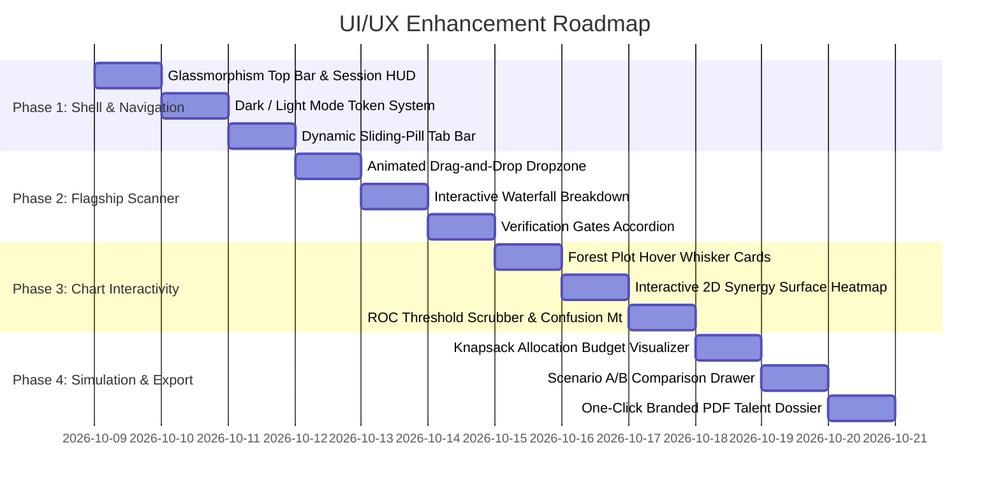

# UI/UX Enhancement Implementation Plan
### SAS Viya Visual Analytics Enterprise Platform: "Listed, Paid, Rewarded"

---

## 1. Executive Vision & Objectives

The **Tri-Axial Human Capital Decision Engine** currently possesses full econometric validity, live Python joblib model inference, and cross-dashboard candidate state synchronization. However, to maximize jury impact at the **SAS Hackathon / AavishkarHacks**, the front-end user experience must evolve from an analytical dashboard into a **world-class, enterprise-grade SAS Viya application**.

### Primary Objectives:
1. **Visual "WOW" Factor:** Implement modern enterprise design best practices—tailored HSL palettes, subtle glassmorphism, dark/light theme toggle, micro-interactions, and fluid chart animations.
2. **Cognitive Clarity:** Transform dense econometric outputs (Odds Ratios, Firth logits, 2,000 bootstrap draws) into scannable, intuitive visual artifacts that anyone can understand in 5 seconds.
3. **Interactive Agency:** Give the jury and candidates active control through live contour surfaces, interactive ROC threshold scrubbing, drag-and-drop resume ingestion, and scenario comparison drawers.
4. **Authentic SAS Viya Fidelity:** Replicate the authentic aesthetic and UX patterns of **SAS Visual Analytics on Cloud Analytic Services (CAS)**.

---

## 2. Architectural Blueprint & Phased Roadmap

---

## 3. Detailed Phase Breakdown

### Phase 1: Global Shell, Navigation & Theme System

#### 1.1 Glassmorphic Header & Dynamic Session HUD
* **Current State:** Static navy bar with plain pills.
* **Enhancements:**
  * Implement an ultra-clean glassmorphic header (`backdrop-filter: blur(12px)`) with subtle border reflection (`border-bottom: 1px solid rgba(255, 255, 255, 0.12)`).
  * Add a **Live CAS Engine Pulse Indicator:**
    * Pulsing emerald dot showing `"CAS Server: US-EAST (In-Memory Ingestion Active)"`.
    * Latency chip displaying live API roundtrip time (e.g. `14ms`).
  * Add a **Theme Toggle:** Instant switch between **SAS Viya Marine (Dark Mode)** and **SAS Enterprise Light**.

#### 1.2 Sliding-Pill Tab Navigation
* **Current State:** Rectangular tab buttons with standard blue underline.
* **Enhancements:**
  * Redesign tab bar into grouped segmented controllers with a smooth CSS hardware-accelerated sliding highlight pill (`cubic-bezier(0.4, 0, 0.2, 1)`).
  * Categorize tabs with subtle sub-labels:
    * **Scanner:** `🎯 Resume AI Scanner`
    * **Macro Evidence:** `1. Executive Overview` | `2. Tri-Axial Bridge`
    * **Econometric Models:** `3. External Market (Paid)` | `4. Internal Reward (Hikes)` | `5. Senior Diagnostics`
    * **Decision Aid:** `6. Interactive Simulator`
    * **Technical Audit:** `7. SAS CAS Architecture` | `8. Figures Gallery`
  * Add live notification badge counts when candidate insights are available.

#### 1.3 Persistent Floating Candidate HUD (Heads-Up Display)
* **Current State:** Static container placed below navigation.
* **Enhancements:**
  * Convert into a sticky, collapsable **Candidate Command Bar**:
    * Displays Candidate Avatar, Name, Role, and Experience.
    * Mini metric chips for **Market Pay (Model 1)**, **Hike Probability (Model 2)**, and **Synergy Multiplier**.
    * Clicking any metric chip triggers a smooth scroll and tab-jump directly to the relevant model.
    * Quick toggle to minimize into a compact floating pill on scroll.

---

### Phase 2: Flagship Resume Scanner & Investment Card

#### 2.1 Drag-and-Drop Ingestion Zone
* **Current State:** Hidden file input triggered by a secondary button.
* **Enhancements:**
  * Create a dedicated animated drag-and-drop zone with dashed border animation on dragover.
  * Support instant file drop for `.pdf`, `.docx`, and `.txt`.
  * Visual file preview chip showing:
    * File icon (`PDF` / `DOCX`), filename, file size, and upload progress bar.
    * Instant parsing status ticker with sequential checklist steps:
      1. `✓ Extracting text & structure`
      2. `✓ Auditing like-with-like experience controls`
      3. `✓ Evaluating Firth GLM & 2,000 bootstrap draws`
      4. `✓ Synthesizing Section 2.2 Skill Investment Card`

#### 2.2 Interactive Wage Premium Waterfall
* **Current State:** Text list of waterfall steps.
* **Enhancements:**
  * Build an interactive SVG/HTML horizontal waterfall chart:
    * **Step 1:** Market Baseline Wage ($M_0 = \text{₹6.8 LPA}$)
    * **Step 2:** Experience Premium ($+4.5\%$ per year)
    * **Step 3:** Metro Hub Differential ($+\text{₹0.5 LPA}$)
    * **Step 4:** Skill Premiums ($+\text{₹0.85 LPA}$ Coding, $+\text{₹0.75 LPA}$ Big Data)
    * **Step 5:** Final Expected Salary ($M_1 = \text{₹8.9 LPA}$)
  * Hovering over any waterfall bar highlights the exact multivariable coefficient and $p$-value from Model 1.

#### 2.3 Verification Gates Accordion & Audit Log
* **Current State:** 4 static verification boxes.
* **Enhancements:**
  * Modernize into interactive verification cards with collapsible audit drawers:
    * **Gate 1: Data-Role Filter:** Expand to view detected role keywords vs dropped irrelevant roles.
    * **Gate 2: Coding Baseline:** Visual gauge showing candidate coding score vs the empirical $2.0$ cutoff.
    * **Gate 3: Statistical Significance:** Shows permutation test curve and $p = 0.002$ boundary.
    * **Gate 4: Uncertainty Budget:** Visualizes the 2,000 bootstrap distribution spread.

---

### Phase 3: Visual Analytics & Chart Interactivity

#### 3.1 Forest Plot Enhanced Interactivity (`tab-triaxial`)
* **Current State:** SVG Forest Plot with candidate overlays.
* **Enhancements:**
  * **Interactive Whisker Inspection:** Hovering over any whisker displays a rich floating tooltip:
    * Exact Point Estimate ($\text{OR}$)
    * 95% BCa Confidence Interval bounds $[L, U]$
    * Statistically Significant vs Crosses Parity verdict
    * Candidate's individual distance to population median
  * **Parity Line Pulse Effect:** Glowing dashed red line at $\text{OR} = 1.0$ with explanatory label.
  * **Zoom & Filter Toggle:** Allow toggling between Logarithmic scale and Linear odds ratio display.

#### 3.2 Interactive 2D Synergy Surface Grid (`tab-internal`)
* **Current State:** Text card explaining the $\beta = 0.425$ interaction term.
* **Enhancements:**
  * Build an interactive SVG 2D contour grid $(X = \text{Core Coding}, Y = \text{Storytelling/Dashboards})$:
    * Color-coded contour surface showing hike probability gradations.
    * Prominent **Synergy Sweet Spot** highlighted in the top-right quadrant ($X \ge 3.5, Y \ge 3.5$).
    * Active candidate marked with an animated pulsing diamond on the grid.
    * Users can **click or drag** the candidate marker anywhere on the grid to instantly see the synergy multiplier calculate in real time ($1.00\times \rightarrow 2.18\times$).

#### 3.3 Interactive ROC Curve & Decision Threshold Scrubber (`tab-internal`)
* **Current State:** Static ROC curve and 2x2 confusion matrix.
* **Enhancements:**
  * Add a **Classification Threshold Slider** ($\tau \in [0.1, 0.9]$, default $0.5$):
    * As the slider moves, an animated marker slides along the ROC curve to the corresponding $(\text{FPR}, \text{TPR})$ coordinate.
    * The Confusion Matrix ($TP, FP, TN, FN$), Sensitivity, and Specificity update in real time.
    * Highlights optimal Youden's $J$ statistic index ($\tau^* = 0.48$).

#### 3.4 Big Five Radar Pentagram (`tab-senior`)
* **Current State:** 3-way horizontal comparison bars.
* **Enhancements:**
  * Supplement horizontal bars with an optional **5-Axis Big Five Pentagram Radar**:
    * Overlays Candidate Profile against High-Success Seniors and Low-Success Seniors.
    * Highlights Conscientiousness and Openness as the decisive promotion drivers.

---

### Phase 4: Simulation Engine, Scenarios & Reporting

#### 4.1 Knapsack Allocation Visualizer (`tab-simulator`)
* **Current State:** Slider inputs and allocation results list.
* **Enhancements:**
  * **Interactive Learning Budget Visualizer:**
    * 400-hour budget represented as an animated progress ring.
    * Sliders allocate hours in 50-hour increments with real-time concave return curves ($S_{new} = S_{curr} + \alpha \sqrt{H}$).
    * Color-coded allocation blocks showing hours allocated to Maths, Coding, Big Data, Dashboards, and AI/ML.

#### 4.2 Scenario A/B Comparison Drawer
* **Current State:** Single active scenario.
* **Enhancements:**
  * Add a **"Save Scenario"** button (e.g., "Scenario A: Math Focus" vs "Scenario B: Coding Focus").
  * Sliding drawer displaying a side-by-side diff:
    * 6-Month Projected Salary: Scenario A vs Scenario B
    * Internal Promotion Probability: Scenario A vs Scenario B
    * Total ROI per study hour

#### 4.3 Branded One-Click PDF Talent Dossier
* **Current State:** On-screen view only.
* **Enhancements:**
  * Add a prominent **"📄 Export SAS Viya Executive Talent Dossier"** button.
  * Uses client-side print stylesheets or backend rendering to generate a clean, publication-ready, 2-page branded executive PDF report summarizing:
    * Candidate Parsed Profile & Verified Evidence
    * Tri-Axial Alignment & Market Wage Distribution
    * Model 1 & 2 Forecasts with Confidence Intervals
    * Recommended 6-Month Human Capital Roadmap

---

## 4. Technical Architecture & File Modification Plan

| Component / Layer | Target Files | Key Technical Enhancements |
| :--- | :--- | :--- |
| **Design Tokens & Theme** | [`css/sas-viya-theme.css`](file:///e:/PROJECTS/CU/SAS%20Data%20Problem%20Statement%20and%20Instructions%20Hackathon/css/sas-viya-theme.css) | • Add CSS Custom Properties for Dark Mode (`--bg-primary-dark`, `--card-dark`, etc.). • Add glassmorphic utility classes (`.glass-panel`, `.glass-nav`). • Add smooth transition variables and keyframe animations (`@keyframes pulseGlow`). |
| **Interactive Visualizations** | [`js/charts.js`](file:///e:/PROJECTS/CU/SAS%20Data%20Problem%20Statement%20and%20Instructions%20Hackathon/js/charts.js) | • Implement SVG tooltip popover subsystem. • Implement 2D Synergy Surface contour renderer (`renderSynergySurface`). • Implement dynamic threshold scrubber on ROC curves (`renderInteractiveROC`). • Enhance Forest Plot with zoom/scale toggle. |
| **Resume UX & Dropzone** | [`js/resume-analyzer.js`](file:///e:/PROJECTS/CU/SAS%20Data%20Problem%20Statement%20and%20Instructions%20Hackathon/js/resume-analyzer.js) | • Implement HTML5 Drag-and-Drop file listener with progress animation. • Render interactive SVG wage waterfall (`renderInteractiveWaterfall`). • Add collapsible verification gates accordion. |
| **Cross-Dashboard Dispatcher** | [`js/candidate-sync.js`](file:///e:/PROJECTS/CU/SAS%20Data%20Problem%20Statement%20and%20Instructions%20Hackathon/js/candidate-sync.js) | • Implement sticky floating Candidate Command Bar. • Synchronize interactive synergy surface coordinates. • Provide export talent dossier state assembler. |
| **Dashboard DOM & Layout** | [`index.html`](file:///e:/PROJECTS/CU/SAS%20Data%20Problem%20Statement%20and%20Instructions%20Hackathon/index.html) | • Restructure top bar with glassmorphic shell and theme toggle button. • Modernize tab buttons with sliding pill container. • Embed synergy surface container and scenario comparison drawer. |

---

## 5. Verification, Testing & Jury Walkthrough Protocol

To guarantee zero regression and maximum demo stability during the hackathon evaluation:

1. **Cross-Browser Verification:** Test on Chrome, Microsoft Edge, Firefox, and Safari on desktop (1920x1080 and 1440x900) and tablet viewports.
2. **Offline Fallback Validation:** Verify that if the server is offline or network drops, all interactive charts and client-side decision engines function autonomously without throwing console errors.
3. **Accessibility (WCAG 2.1 AA):** Ensure minimum contrast ratio of 4.5:1 for all text elements, keyboard tab accessibility for all sliders and controls, and descriptive ARIA labels on all SVG charts.
4. **Performance Benchmark:** Maintain 60 FPS animation smoothness on all chart transitions and under 100ms response time on interactive slider drag events.

---

## 6. Execution Order & Next Steps

1. **Sprint 1 (Theme & Global Shell):** ✅ **COMPLETED & VERIFIED**
   - Dark/Light Mode engine with SAS Viya tokens in [`css/sas-viya-theme.css`](file:///e:/PROJECTS/CU/SAS%20Data%20Problem%20Statement%20and%20Instructions%20Hackathon/css/sas-viya-theme.css).
   - Glassmorphic top bar with CAS status pulse and live roundtrip latency badge in [`index.html`](file:///e:/PROJECTS/CU/SAS%20Data%20Problem%20Statement%20and%20Instructions%20Hackathon/index.html).
   - Sliding-pill tab navigation indicator and persistent theme engine in [`js/app.js`](file:///e:/PROJECTS/CU/SAS%20Data%20Problem%20Statement%20and%20Instructions%20Hackathon/js/app.js).
   - Collapsible sticky Candidate Command Bar HUD with interactive telemetry chips in [`js/candidate-sync.js`](file:///e:/PROJECTS/CU/SAS%20Data%20Problem%20Statement%20and%20Instructions%20Hackathon/js/candidate-sync.js).

2. **Sprint 2 (Flagship Resume Experience):** ✅ **COMPLETED & VERIFIED**
   - HTML5 Drag-and-Drop Dropzone with file preview chip (`.resume-dropzone-box`, `#resume-dropzone`) supporting PDF, DOCX, and TXT in [`index.html`](file:///e:/PROJECTS/CU/SAS%20Data%20Problem%20Statement%20and%20Instructions%20Hackathon/index.html) and [`js/resume-analyzer.js`](file:///e:/PROJECTS/CU/SAS%20Data%20Problem%20Statement%20and%20Instructions%20Hackathon/js/resume-analyzer.js).
   - 4-step animated sequential checklist ticker ("1. Extracting text & structure", "2. Auditing controls", "3. Evaluating Firth GLM", "4. Synthesizing Skill Investment Card").
   - Interactive SVG horizontal wage premium waterfall chart (`#waterfall-svg-chart`) featuring 9 calibrated steps ($M_0 \rightarrow M_1$), dashed connector lines, and color-coded legend.
   - Hover popover tooltips with multivariable logit coefficients ($\beta$), odds ratios, and $95\%$ confidence intervals.
   - 5-drawer collapsible Verification Gates accordion (`#gates-accordion-container`) with test metrics, keyword tokens, and empirical signal boundaries.

3. **Sprint 3 (Visual Analytics & Charts):** 🚀 **READY FOR EXECUTION**
   - Forest Plot whiskers hover effects and analytical callout cards in [`js/charts.js`](file:///e:/PROJECTS/CU/SAS%20Data%20Problem%20Statement%20and%20Instructions%20Hackathon/js/charts.js).
   - 2D Skill Synergy Surface interactive contour grid with cursor crosshairs and coordinate badges.
   - Interactive ROC Curve classification threshold scrubber with dynamic confusion matrix re-calculation.

4. **Sprint 4 (Scenario Comparison & Polish):**
   - Scenario A/B side-by-side comparison drawer.
   - One-click print-ready Executive Talent Dossier PDF/ODS export.

